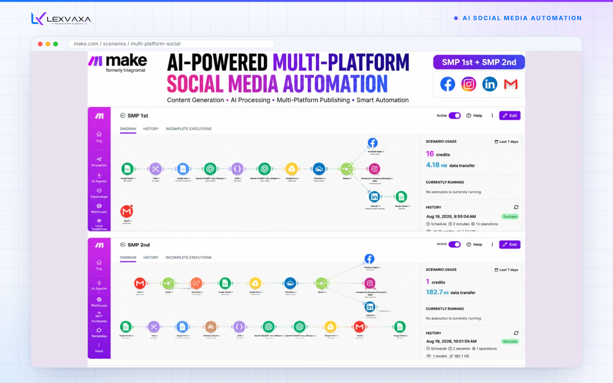

<!-- styled:v2 -->

**AI workflows that turn one content source into platform-specific posts and publish them to LinkedIn, Facebook, Instagram and X.**

  
  
  
  
  
  
  
  

  <a href="#overview">Overview</a> ·
  <a href="#key-features">Key features</a> ·
  <a href="#results">Results</a> ·
  <a href="#screens">Screens</a> ·
  <a href="#tech-stack">Tech stack</a>

---

## Overview

Creating and publishing content by hand across several platforms took constant effort. Lexvaxa built a set of AI social media automations in n8n and Make. Content comes from one central source, AI models generate and customise it for each platform, video content is analysed and summarised, media is processed and stored, and posts are scheduled and published through connected APIs to LinkedIn, Facebook, Instagram and X, so content stays consistent everywhere. Screens shown use sample data, so no client records are exposed.

## The challenge

Each platform needed its own version of every post, and publishing by hand was slow and inconsistent.

## The solution

Modular n8n and Make workflows with OpenAI and Claude for content, Cloudinary for media, Airtable for planning and webhooks for scheduled publishing.

## Key features

- One content source for every platform
- AI content generation tailored to each platform
- AI video processing, analysis and summarisation
- Automated media handling and storage
- Scheduled publishing to LinkedIn, Facebook, Instagram and X
- Webhook-based workflows with Airtable planning

## Results

- Content operations stay consistent across every platform
- One central, scalable social media workflow instead of manual posting

## Tech stack

        

## Screens

## Privacy

Client names and records are confidential. Every screen in this repository uses sample data, and source code that belongs to the client is not published.

## Links

- Case study on Lexvaxa: https://lexvaxa.com/work/ai-social-media-automation

---

**Built by [Ch Muhammad Samiullah](https://github.com/samiullah156-creator)** · AI Automation Engineer and Full-Stack Developer at [Lexvaxa](https://lexvaxa.com)

⭐ Star this repo if you found it useful

